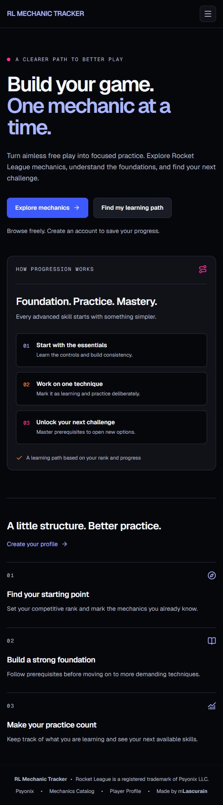
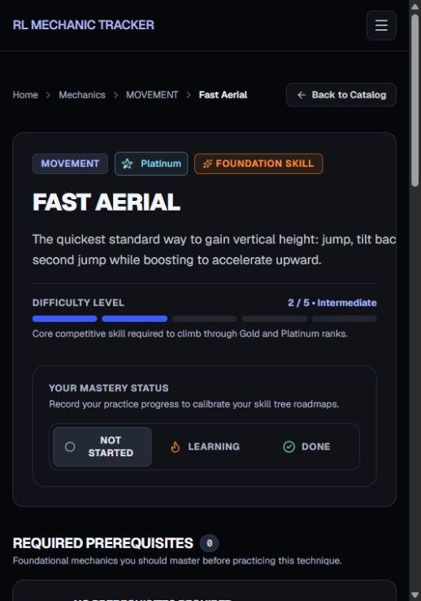

# RL Mechanic Tracker

**Build your game. One mechanic at a time.**

RL Mechanic Tracker helps Rocket League players turn free play into focused practice. Discover techniques, understand how they connect, and build a learning path around your competitive rank and progress.

[Explore RL Mechanic Tracker](https://rl-mechanic-tracker.vercel.app/)

## A clearer path to better play

Knowing what to practice next can be as challenging as learning the mechanic itself. RL Mechanic Tracker brings mechanics, prerequisites, and training resources together so players can work on their foundations and move toward more advanced techniques with a clear direction.

Browse the catalogue freely, or create a player profile to save your progress and get recommendations based on your rank and the skills you have already mastered.

## What you can do

- **Find your next mechanic.** Search the catalogue and filter by category, difficulty, recommended rank, or mastery status.
- **Understand the foundations.** Explore prerequisites and see which advanced techniques each mechanic helps unlock.
- **Practice with a purpose.** Access community tutorials and copy available custom training pack codes to use in Rocket League.
- **Keep track of your progress.** Mark mechanics as Learning or Done, and review your progress by rank and category.
- **Make your learning path personal.** Set your competitive rank and discover recommendations informed by your completed prerequisites.

Recommended ranks are learning guidelines, rather than requirements for ranking up.

## From discovery to practice

Each mechanic brings its difficulty, prerequisites, related techniques, and available training resources into one place. Signed-in players can record their mastery status as they practice.

## Your practice, connected

Your profile, progress overview, and learning path work together: choose your current rank, record the mechanics you are learning, and use your completed foundations to guide your next challenge.

[Start exploring](https://rl-mechanic-tracker.vercel.app/mechanics)

---

Created by [mLascurain](https://github.com/mLascurain).

An independent community project. Rocket League is a registered trademark of Psyonix LLC. Training resources belong to their original creators. [Rank asset credits](public/ranks/README.md).
